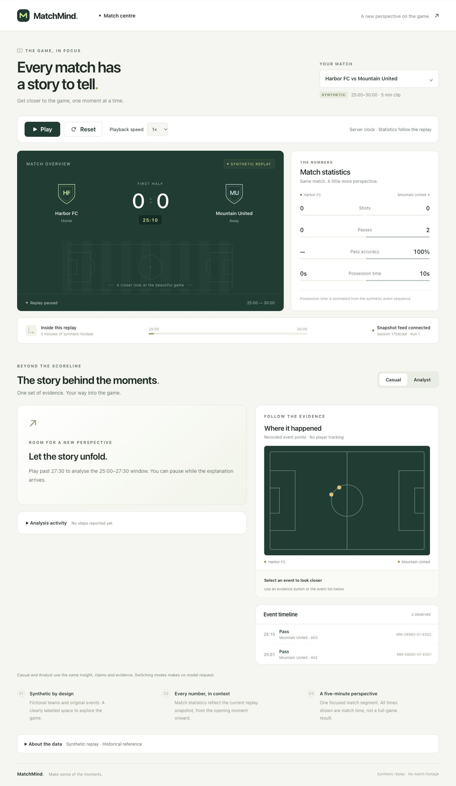
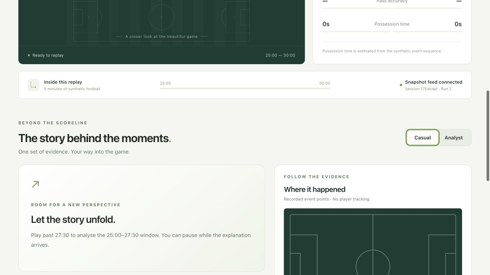

# Native browser SSE retry — 2026-10-25

Role A, contract 2.0.0. Main remained `0df6144`, with #14 awaiting C review. Tested application source/build: `86564f8`, assets `index-C8F7BEC-.js` / `index-GQj0pIxq.css`. This slice adds an offline manual test proxy and evidence, with no application/API/fixture/deployment change.

## Method

The real integrated B/C app ran with explicit `MATCHMIND_MODEL_PROVIDER=mock`, `MATCHMIND_SERVE_FRONTEND=1` and `MATCHMIND_DATA_DIR=data/extra/validated-demo` on loopback port 18400. A separate browser tab used loopback port 18401 through `tests/frontend/browser-reconnect-proxy.mjs`.

The proxy forwards the real app's HTTP/SSE bytes and headers. It does not create an EventSource, synthesize events or implement a reconnect loop. One `SIGUSR2` to its own printed PID destroyed the active downstream SSE response, while the upstream backend process stayed alive. The application continued using its browser-native EventSource. No page reload, Retry button, subscription replacement or second replay was requested to recover.

The helper accepts only a plain `http://127.0.0.1` upstream and a distinct unprivileged port. It refuses production or model-ready health responses before listening. Operators must still explicitly configure the mock provider; health alone does not attest provider configuration. It is a manual macOS/Linux tool, outside ordinary tests/CI and the production bundle, with no HTTP fault-control endpoint.

## Observed result

- Playback speed was set to 1x, played until two actual events appeared, then paused at **25:10**. Baseline: run 1, away passes 2, away pass accuracy 100%, possession 0s/10s, shots 0/0 and two distinct timeline IDs.
- Exactly one stream was cut. The initial stream had no `Last-Event-ID`; the browser's second request used the same replay path and automatically supplied `R-d9986a8b8e414e2d8eba8441175dcdaf:1:26`.
- The proxy closed the first stream at `08:14:10.684Z` and received the second request at `08:14:13.688Z`: **3004 ms** between closure and retry-request arrival. This is one local observation, not total UI recovery duration, a benchmark or a production latency claim.
- The first browser read after the cut already reported `Snapshot feed connected`. The transient reconnecting banner was **not captured**; no duration is claimed for it.
- Before/after UI records were equal: paused at 25:10, same replay/run, identical statistics, identical two event IDs and no duplicated timeline entries. This paused-case test does not establish lossless event delivery while playing.
- The Reset button still worked: idle at 25:00, same replay run 2, zero statistics and an empty event list, with the feed connected. No AI window was reached; the provider was explicitly mock and there were zero model calls.

[Structured result](2026-10-25/reconnect/result.json) includes the actual before/after/reset UI strings and the request gap. [Proxy log](2026-10-25/reconnect/proxy.jsonl) preserves the two real requests, one injected closure, normal browser-tab closure and clean proxy shutdown. The temporary tab, proxy and upstream server were all stopped.





## Reproduction

From `matchmind/`, after building the current frontend, start the upstream:

```sh
MATCHMIND_MODEL_PROVIDER=mock MATCHMIND_SERVE_FRONTEND=1 MATCHMIND_DATA_DIR=data/extra/validated-demo .venv/bin/python -m uvicorn ai.app:app --host 127.0.0.1 --port 18400 --workers 1
```

In a second terminal:

```sh
node tests/frontend/browser-reconnect-proxy.mjs --upstream http://127.0.0.1:18400 --port 18401
```

Open `http://127.0.0.1:18401/` in a fresh browser tab. Select 1x, play until events appear, then pause before 27:30. Record clock/statistics/event IDs. From another terminal send `SIGUSR2` to the numeric PID printed in the proxy's `ready` line, using `kill -USR2` followed by that PID. Confirm the new native SSE request, cursor header and recovered UI without reloading or pressing Retry, then Reset. Close the browser tab and stop both owned servers.

Validation for this slice: helper syntax and `--help` passed; an HTTPS production URL was refused before any request; a local stub advertising production/model-ready health was refused before listening. The actual browser run establishes the forwarding/cut/retry path. Frozen-file, A-scope, result/log consistency and whitespace checks apply. Existing application tests are unchanged; normal CI still runs the full offline suites.

This closes the **local** native automatic-retry gap. Public Render browser retry behavior and expanded insight/evidence/mode acceptance, C's actual calibration/adoption decision, final video and representative review remain separate work.
