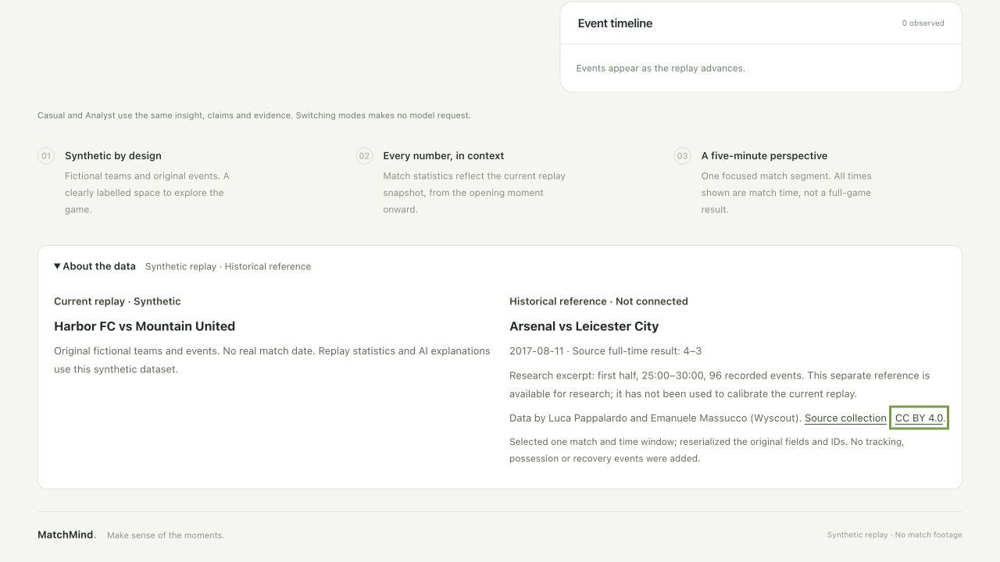
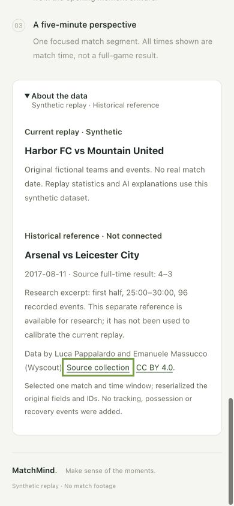

# Source disclosure browser acceptance — 2026-10-25

Role A; contract 2.0.0. Fetched main remains `0df6144`; PR #14 is still open with C's review requested. Application source/build tested: `409d25c5277dfc01e7cde07ad250aa5a99763c05`, assets `index-C8F7BEC-.js` / `index-GQj0pIxq.css`. This follow-up adds reviewable evidence; it changes no application code, bundle, dataset or API.

## Environment and observed behavior

The integrated B/C app ran on `http://127.0.0.1:18400/` with `MATCHMIND_MODEL_PROVIDER=mock`, `MATCHMIND_SERVE_FRONTEND=1`, `MATCHMIND_DATA_DIR=data/extra/validated-demo`, one worker and a separate in-app browser tab. The replay was left idle at 25:00: no playback commands, AI window or model calls were requested. The source reference remained separate from the replay.

The browser's isolated tab API worked in this attempt, resolving the earlier native Edge input limitation for these local checks. This does not establish public behavior on the unpublished bundle.

## Keyboard and accessible state

1. Focused the `About the data` disclosure and pressed Space. The accessible tree reported its button as expanded and exposed both source sections.
2. Pressed Return. The tree reported the same disclosure as collapsed and removed the reference content.
3. Pressed Space again, then Tab. Focus reached `Source collection`, with the versioned collection DOI as its link target.
4. Pressed Tab. Focus reached `CC BY 4.0`, with the official license URL as its target.
5. At mobile width, Shift+Tab reached `Source collection` and brought the entire expanded source panel into view. The screenshot shows its focus outline.

This establishes keyboard activation, disclosure state and link order in this browser. It is not a VoiceOver/NVDA user test. The external links were inspected, not followed; no external form or permission prompt was submitted.

## Responsive layout

Both explicit viewports were measured through read-only DOM geometry and visually inspected. The source disclosure remained open. Measurements and screenshot names are in [the acceptance record](2026-10-25/source-acceptance.json).

| Viewport | Document scroll width | Source bounds | Source sections | Observation |
| --- | --- | --- | --- | --- |
| 1280×720 | 1280px | x=48–1232; y=314.06–627.24 | Two 559px columns | Both source identities, body text, attribution and focused license link fit; no horizontal overflow. |
| 390×844 | 390px | x=20–370; y=132.77–726.33 after keyboard navigation | Two 308px sections, stacked | Entire source panel and footer are visible; long copy wraps within the card; no horizontal overflow. |

These are emulated browser viewport checks, not a physical-phone test. The viewport override was reset, the temporary tab closed and the owned mock server stopped after verification.

### Desktop



### Mobile



## Content boundaries and remaining acceptance

The current replay is labelled synthetic and retains Harbor FC / Mountain United. The separate reference is labelled `Historical reference · Not connected`, Arsenal–Leicester City, 2017-08-11, **source full-time** 4–3, first-half 25:00–30:00 / 96 records, with creators/provider/DOI/license and the selection/reserialization notice. It says calibration has not happened. No real event was offered as a playable match or sent to a model.

The earlier source verifier, 29 frontend tests, 440 Python tests / 69 subtests and real B/C consumer checks remain the relevant source/API evidence; they were not rerun solely for screenshots. Frozen-file, A-scope, image/report consistency and whitespace checks are performed for this evidence-only update.

Local source-disclosure keyboard and expanded responsive acceptance are now complete for this build. Public deployment and the public expanded insight/evidence/audience-mode walkthrough, browser-native EventSource retry timing, final English video and representative review remain outstanding. C still coordinates actual historical-data adoption/calibration in #15 and reviews/merges #14. This local acceptance makes no cloud or real-data integration claim.

To reproduce, build this checkout with `pnpm run build` from `frontend/`, then start the server below from `matchmind/` and repeat the keyboard sequence at the two viewport sizes. Stop it with Ctrl+C afterward.

```sh
MATCHMIND_MODEL_PROVIDER=mock MATCHMIND_SERVE_FRONTEND=1 MATCHMIND_DATA_DIR=data/extra/validated-demo .venv/bin/python -m uvicorn ai.app:app --host 127.0.0.1 --port 18400 --workers 1
```
